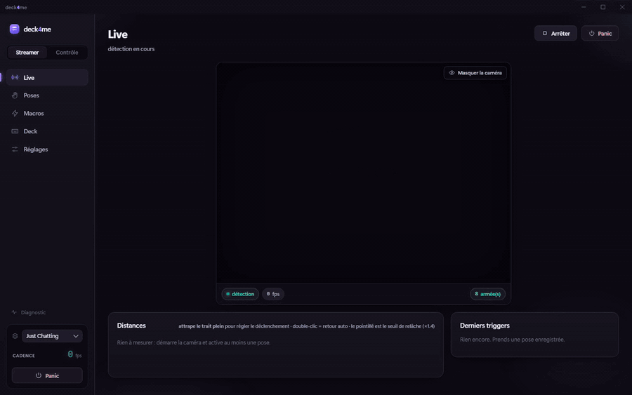

# deck4me

[English version](README.md)

deck4me est une application de bureau Windows pour les streamers. Elle lit votre webcam, reconnaît des poses de votre visage et de vos mains, et déclenche un meme (une image, une animation ou un son) sur votre stream quand vous tenez une pose. Tout tourne sur votre machine, le modèle de détection est embarqué et rien n'est envoyé à un serveur.

L'application est construite avec Tauri v2. Un serveur axum local alimente une page d'overlay que l'on ajoute à OBS comme source navigateur. L'interface est en français.

## Fonctionnalités

- Détection de poses du visage (26 blendshapes retenus) et des mains, avec MediaPipe exécuté en local et hors ligne.
- Un assistant d'enregistrement qui apprend une pose en trois prises courtes, refuse deux poses trop proches et vérifie le résultat contre votre parole normale.
- Un réglage de sensibilité par pose, et une vue en direct qui montre la distance à chaque pose pendant que vous bougez.
- Un éditeur de meme pour la position, la taille, les effets d'entrée et de sortie, la durée et un son optionnel. Il accepte png, gif, webp, avif, jpg et webm, et il sait détourer un fond uni.
- L'import d'images depuis un fichier ou depuis une adresse web collée, avec des garde-fous contre le sondage du réseau local.
- Des macros qui enchaînent deux à quatre poses dans une fenêtre courte, pour que les actions sensibles ne partent jamais par accident.
- Des actions attachées à une macro pour ouvrir un fichier ou un lien, lancer un programme, envoyer un raccourci clavier, taper du texte, appeler un point d'accès HTTP ou attendre.
- Des profils, des raccourcis globaux et un bouton panic qui vide l'overlay d'un coup.
- Un deck clavier sur le pavé numérique, avec son propre widget.
- Une caméra virtuelle nommée "deck4me Camera", fondée sur le filtre DirectShow Softcam, pour partager la webcam entre deck4me et Streamlabs ou OBS. Les memes peuvent aussi être dessinés sur cette caméra pour Discord ou Zoom.
- Un mode Streamer et un mode Contrôle, et des mises à jour automatiques signées.

## Démo



L'enregistrement existe aussi en [fichier MP4](docs/media/demo.mp4). Il a été réalisé en lançant le front du studio dans Chromium avec un backend Tauri simulé et une caméra synthétique, avec des poses et des memes fictifs. Il ne montre pas l'application native, ni une vraie webcam, ni aucune donnée personnelle. Les légendes sont en français, comme l'interface.

## Prérequis

- Windows 10 ou 11, avec WebView2 (préinstallé sur Windows 11).
- Node.js 20 ou plus récent.
- Rust avec la chaîne d'outils MSVC.
- Visual Studio Build Tools 2022 avec la charge de travail "Développement Desktop en C++", uniquement pour compiler le filtre de caméra virtuelle.
- Une connexion réseau une seule fois, pour télécharger les fichiers MediaPipe (environ 90 Mo, absents du dépôt).

## Installation

```bash
npm run setup
npm --prefix packages/studio install
```

La première commande installe les dépendances du workspace, télécharge les fichiers MediaPipe, génère les icônes et compile le filtre de caméra virtuelle. La seconde installe les dépendances du studio, qui ne fait pas partie du workspace npm.

Pour construire l'installeur :

```bash
npm run build:app
```

L'installeur est écrit dans `src-tauri/target/release/bundle/nsis/`. Le build est signé, voir la section sur les versions plus bas.

## Développement

```bash
npm run dev
```

Cette commande lance `tauri dev`, qui compile la partie Rust et sert le studio sur le port 4200.

Les scripts définis dans le `package.json` racine sont les suivants.

| Script | Ce qu'il fait |
| --- | --- |
| `npm run setup` | Installe les dépendances, les fichiers MediaPipe, les icônes et le build softcam. |
| `npm run vendor` | Télécharge les fichiers wasm et les modèles MediaPipe. |
| `npm run icons` | Génère les icônes Tauri et l'image de test par défaut. |
| `npm run softcam` | Compile le filtre de caméra virtuelle avec MSBuild. |
| `npm run dev` | Lance l'application en mode développement. |
| `npm run dev:front` | Compile l'overlay et sert le studio seul, sans Tauri. |
| `npm run build:front` | Compile l'overlay et le studio. |
| `npm run build:app` | Construit l'installeur signé. |
| `npm test` | Lance les tests unitaires du paquet core avec vitest. |

Autres commandes utiles :

```bash
npm run build -w @deck4me/core
npm --prefix packages/studio run build
cargo test --manifest-path src-tauri/Cargo.toml
```

La première vérifie les types du paquet core et la deuxième compile le studio. Lancer le studio seul dans un navigateur fonctionne, mais les commandes Tauri sont alors indisponibles et l'interface n'affiche que des données vides.

### Versions

Les mises à jour sont signées. Le script de build lit le chemin de la clé de signature dans la variable d'environnement `DECK4ME_SIGNING_KEY`, et le mot de passe de la clé dans `TAURI_SIGNING_PRIVATE_KEY_PASSWORD`. La clé privée et son mot de passe se gèrent hors du dépôt et ne doivent jamais être commités. Après un build, `node scripts/make-latest-json.mjs "Notes de version"` écrit le manifeste `latest.json` que l'updater télécharge.

## Structure du dépôt

```
packages/core      featurizer de poses, matcher, machine à états et macros, en TypeScript pur avec tests
packages/overlay   la page d'overlay pour OBS, bundlée en un seul HTML et embarquée dans le binaire Rust
packages/studio    l'interface Angular de l'application
src-tauri          le shell Tauri, le serveur local, le moteur d'actions et la pompe de caméra virtuelle
vendor/softcam     le filtre DirectShow Softcam, sous licence MIT
scripts            scripts d'installation, de récupération des binaires, d'icônes, de softcam et de release
phase0             un banc d'essai autonome dans le navigateur, utilisé pour valider l'approche de détection
docs/media         l'enregistrement de démonstration
```

## Licence

Copyright (c) 2026 Mehdi Zenati. deck4me est **source disponible** sous double licence. Il est gratuit pour un usage personnel non commercial, et une licence payante est requise pour un usage commercial et professionnel. Voir [LICENSE](LICENSE) pour les termes exacts. Les bibliothèques tierces conservent leurs propres licences, dont Softcam dans [vendor/softcam](vendor/softcam/LICENSE).
